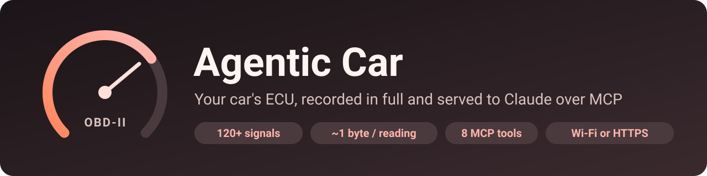
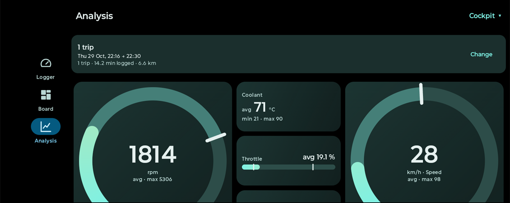
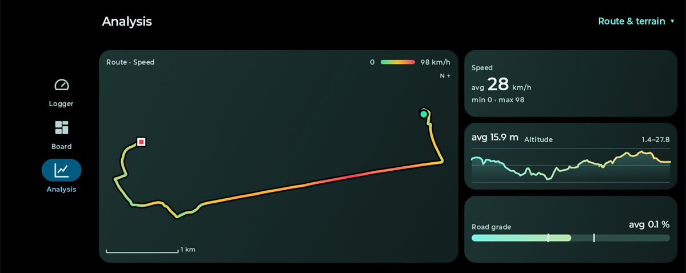
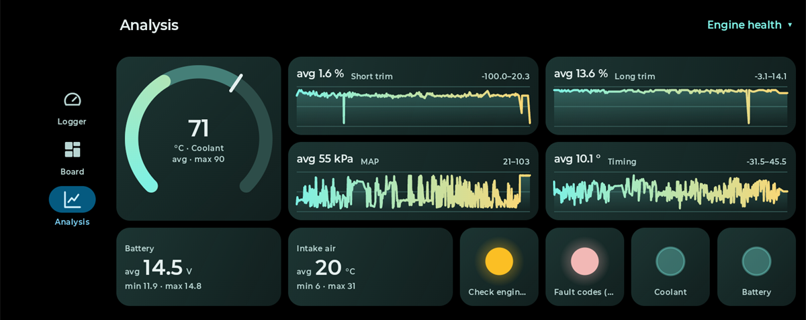
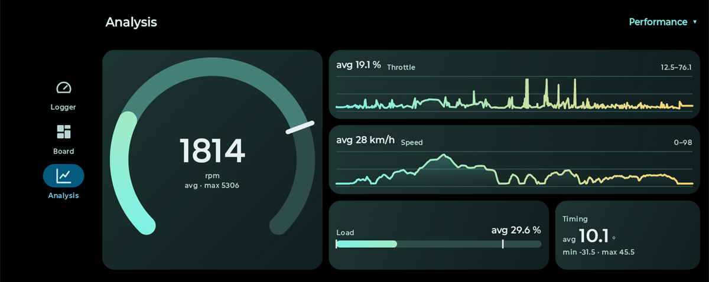
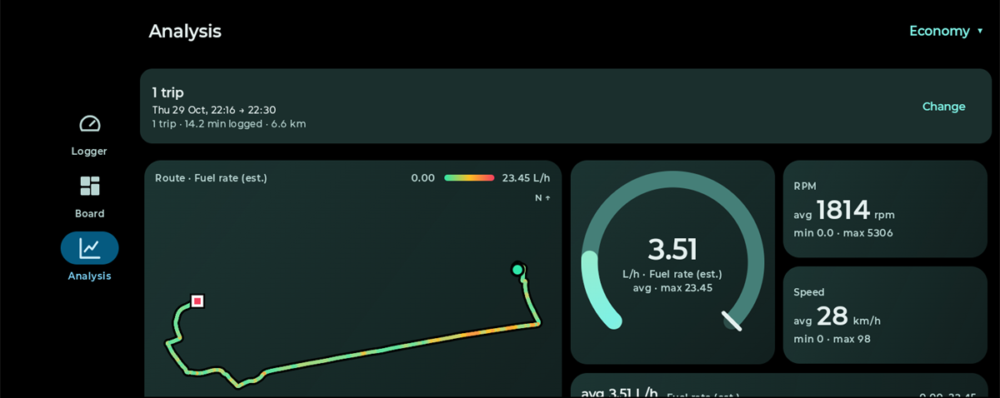
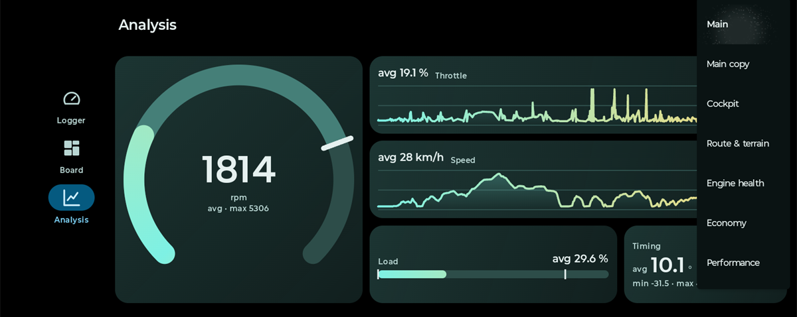
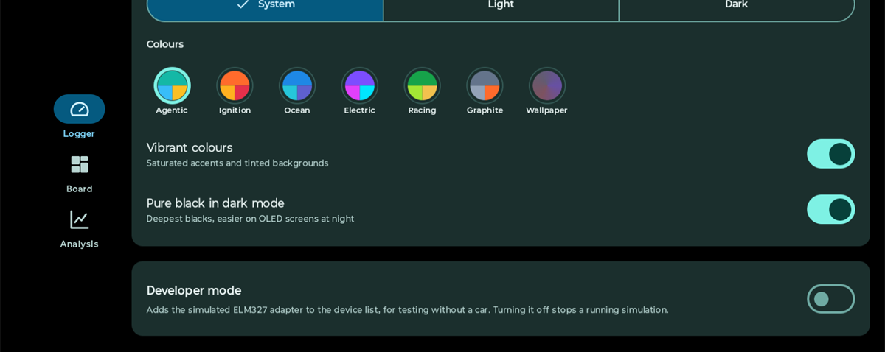
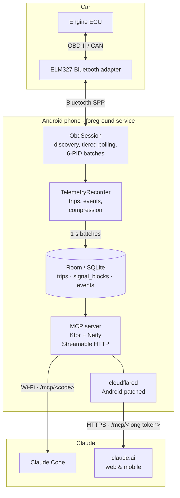

<p align="center">
  
</p>

<p align="center">
  <a href="https://github.com/Shreyamkmr/AgenticCar/releases/latest"></a>
  
  
  
  
  <a href="LICENSE"></a>
</p>

**Agentic Car** turns an Android phone and a cheap ELM327 Bluetooth adapter into a full-fidelity car data logger with dashboards you design yourself, then lets Claude read it. While you drive, it records **every signal your car's ECU supports**, compressed to about a byte per reading. Lay out live dials, trends and a GPS route map however you like, replay any trip through the same tiles, and switch on the phone's built-in **MCP server** to ask Claude about your drives.

<p align="center">
  
</p>

<table>
  <tr>
    <td width="50%"></td>
    <td width="50%"></td>
  </tr>
  <tr>
    <td align="center"><b>Route &amp; terrain</b>: the drive coloured by speed, with altitude and grade</td>
    <td align="center"><b>Engine health</b>: temperatures, fuel trims, ignition and warning lamps</td>
  </tr>
  <tr>
    <td></td>
    <td></td>
  </tr>
  <tr>
    <td align="center"><b>Performance</b>: rev counter with throttle and speed traces</td>
    <td align="center"><b>Economy</b>: where the fuel went, on the map and on a dial</td>
  </tr>
</table>

<p align="center"><sub>Real data from a 14-minute drive in a Peugeot 208 1.2, shown in the Analysis page with the built-in templates.</sub></p>

> 💬 *"How did the engine warm up on this morning's drive?"*
>
> 💬 *"Were there any harsh braking events last week, and at what speed?"*
>
> 💬 *"My long-term fuel trim looks high: plot it against load and tell me if it points to a vacuum leak."*
>
> 💬 *"How much harder does the engine work on the hills of my commute? Map the route and show where it struggles."*

---

## Contents

- [Highlights](#highlights)
- [Dashboards and analysis](#dashboards-and-analysis)
- [How it works](#how-it-works)
- [Quick start](#quick-start)
- [Connect Claude](#connect-claude)
- [MCP tools](#mcp-tools)
- [What gets recorded](#what-gets-recorded)
- [Storage format](#storage-format)
- [Security model](#security-model)
- [Build from source](#build-from-source)
- [Project layout](#project-layout)
- [Limitations and roadmap](#limitations-and-roadmap)
- [Support the project](#support-the-project)
- [License](#license)

## Highlights

| | |
|---|---|
| 🎛️ **Dashboards you design** | A snap-to-grid Board of gauges, trends, values, bars, warning lamps and a route map for any signal. Drag to move, pull a corner to resize, with separate portrait and landscape arrangements and five ready-made templates. |
| 📊 **Replay any drive** | Pick trips or a time range and the same tiles show averages, min–max bands, full-trip trends and whether a lamp ever lit. |
| 🗺️ **Route maps without a map SDK** | The GPS track drawn on the phone, coloured by speed, fuel use or any signal, with a scale bar. No API key, no network. |
| 🎨 **Make it yours** | Light, dark or system theme, seven colour palettes (or your wallpaper's Material You colours), vibrant or calm, and pure black for night driving. |
| 🔍 **Everything the ECU offers** | Asks the car which Mode 01 PIDs it supports and polls all of them: 120+ decoded signals from 90+ standard PIDs, plus raw storage for anything unknown. Also reads the VIN and stored, pending and permanent trouble codes. |
| ⚡ **Built for slow adapters** | Tiered polling (250 ms for driving inputs, up to 5 min for constants) and up to **6 PIDs per request** on CAN cars, detected automatically. |
| 🗜️ **Tiny, lossless-where-it-matters storage** | One-minute blocks per signal, delta + varint encoded at the ECU's native resolution with a small noise deadband: **~1 byte per reading**. Exact min/max/mean are kept for every minute. |
| 🧠 **Made for AI analysis** | 9 MCP tools: trip summaries with derived insights, resampled time series, GPS routes, detected events (harsh braking, over-rev, overheating, DTC changes) and diagnostics. |
| ⛰️ **GPS, elevation and road grade** | Optional 1 Hz GPS track with sea-level altitude and a noise-resistant road grade, so Claude can compare engine load, RPM and fuel use on climbs, flats and descents. |
| 🌍 **Reach it from anywhere** | Wi-Fi with a short typeable code, or a public HTTPS URL through a **Cloudflare Tunnel that runs on the phone itself**: no PC or port forwarding needed. |
| 🔐 **Secure by default** | Secret-path tokens, the Wi-Fi code is refused through any tunnel, public access is off until you switch it on, and the server never listens on the mobile network. |
| 🧪 **Test without a car** | A built-in simulated ELM327 and ECU, behind an in-app **Developer mode** switch (off by default), replays a realistic drive: discovery, multi-frame replies, a harsh brake, fault codes and a VIN. |

## Dashboards and analysis

The app has three tabs: **Logger** (connection, recording, MCP server and settings), **Board** (your live dashboard) and **Analysis** (any past drive through the same tiles). Held sideways, the tabs move to a side rail so a whole board fits on one screen.

### Board

A board is a grid of tiles: 4 columns in portrait and 8 in landscape, each orientation arranged separately. Every tile shows one signal in one of six styles:

| Style | Live | In Analysis |
|---|---|---|
| **Gauge** | 270° dial with a gradient sweep, red near the top of its range | Average, with the min–max band and a peak marker |
| **Trend** | The last 2 minutes | The whole selection, peaks preserved, gaps between trips squeezed out |
| **Value** | Big number, with the 5-minute min and max | Average, min and max |
| **Bar** | Fill bar | Average fill with min and max markers |
| **Lamp** | Warning light at a threshold you choose | Whether it lit at any point |
| **Route** | The last 5 minutes of GPS track, with a heading arrow | The whole drive, start to finish, coloured by the tile's signal |

Tap **Edit**, then long-press a tile to drag it, pull its corner to resize it, or tap it to change its signal, style or range. Tiles snap to the grid, and a ghost outline turns red where a tile would overlap. Layouts are named and saved on the phone; save a copy, rename or delete from the layout menu.

### Templates

Five ready-made layouts are added on first launch and can be added again from **layout menu → Add a template…**. Each has a hand-made landscape arrangement that fits one screen without scrolling, and a portrait one that scrolls.

| Template | What it shows |
|---|---|
| **Cockpit** | Big RPM and speed dials with coolant, throttle and load between them |
| **Route & terrain** | Route coloured by speed, with altitude and road grade |
| **Engine health** | Coolant, short and long fuel trims, manifold pressure, timing, battery, intake air and four warning lamps |
| **Economy** | Route coloured by fuel use, a fuel-rate dial and trend, RPM and speed |
| **Performance** | Large rev counter, throttle and speed traces, load and timing |

### Analysis

Choose **trips** (sub-minute fragments are hidden) or a **time range** (last hour, today, yesterday, last 7 days or any dates and times), pick a layout and tap **Analyse**. Averages are time-weighted, since stored data is dense where values change and sparse where they hold steady. Readings from trips recorded before the current spike rules are cleaned the same way as live data. Switching layouts after a run is instant.

### Appearance

<table>
  <tr>
    <td width="50%"></td>
    <td width="50%"></td>
  </tr>
  <tr>
    <td align="center">Switch layouts from the top bar</td>
    <td align="center">Theme, palette, vibrancy and pure black</td>
  </tr>
</table>

The **Appearance** card on the Logger tab sets **System, Light or Dark**, one of seven palettes (**Agentic**, **Ignition**, **Ocean**, **Electric**, **Racing**, **Graphite**, or **Wallpaper** for Material You), **Vibrant colours** and **Pure black** in dark mode. Each palette is generated from three seed colours, and accents are adjusted until text on them meets WCAG AA contrast, so every palette stays readable in light and dark.

## How it works



1. **Connect.** The app opens a Bluetooth SPP link to the adapter, initialises it (`ATZ`, `ATE0`, `ATL0`, `ATS0`, `ATH0`, `AT SP 0`) and walks the `0100`/`0120`/… bitmaps to find every supported PID.
2. **Record.** A trip starts when the engine runs (RPM > 400 or charging voltage > 13.5 V) and ends 30 s after it stops. Each reading is compressed into its signal's open one-minute block; a single writer commits batches to Room every second.
3. **Serve.** The MCP server reads from Room, so recorded trips are available with or without the car connected.

## Quick start

1. **Install** the APK from the [latest release](https://github.com/Shreyamkmr/AgenticCar/releases/latest) (allow installs from your browser or file manager).
2. **Pair** your ELM327 adapter in Android's Bluetooth settings (PIN is usually `1234` or `0000`).
3. **Open Agentic Car**, grant *Nearby devices* and *Notifications* (and optionally *Location* for the GPS track), pick the adapter and tap **Connect**. With the ignition on, it discovers the car's signals and starts a trip when the engine runs.
4. **Watch it live** on the **Board** tab: pick a template from the layout menu at the top, or tap **Edit** and build your own.
5. **No car handy?** Turn on **Developer mode** at the bottom of the Logger tab and pick **Simulated ELM327** in the adapter list.

The app records in a foreground service, so you can lock the phone and drive.

## Connect Claude

Switch on **MCP server** in the app. The card shows the server's address.

### Claude Code (same Wi-Fi)

```bash
claude mcp add --transport http agentic-car http://<phone-ip>:8080/mcp/<code>
```

`<code>` is the short 6-character token shown in the app. It is easy to type, and it is refused for any request that arrives through a tunnel.

> **Tip:** reserve the phone's IP address in your router's DHCP settings so the URL never changes.

### claude.ai, web and mobile (anywhere)

1. In the app, open **MCP server → Set up** (Public access).
2. Choose a tunnel:
   - **Quick tunnel**: free, no account. The `*.trycloudflare.com` URL changes every time the tunnel starts.
   - **Cloudflare named tunnel**: free account plus your own domain, for a fixed URL. In Zero Trust → Networks → Tunnels, add a published application pointing to `http://127.0.0.1:8080`, then paste the tunnel token and hostname into the app.
3. Switch **Public access** on, tap **Copy URL**, and add it in claude.ai under **Settings → Connectors → Add custom connector**.

Public access starts the bundled `cloudflared` on the phone, so it keeps working on mobile data. Switch it off and tunnelled requests are refused immediately.

## MCP tools

| Tool | What it returns |
|---|---|
| `get_vehicle_info` | VIN, OBD protocol, adapter, fuel type and every supported signal (key, name, unit, polling tier). |
| `get_latest_metrics` | Live values of every signal, trip status and recorder statistics. |
| `list_trips` | Trips, newest first: duration, distance, fuel used and L/100 km, max speed/RPM/coolant, idle share, average moving speed. |
| `get_trip_summary` | Min/max/mean of every signal, event counts, and insights: time in speed and RPM bands, warm-up time to 80 °C, charging and resting voltage, plus elevation (range, climb, descent) and engine load, RPM, fuel use and speed per road-grade band. Also works over any absolute time window. |
| `get_signal_series` | Chosen signals resampled onto a shared time axis (mean, min or max per bucket), with zoom via `from_s`/`to_s`. |
| `get_route` | The GPS track as rows of time, latitude, longitude, altitude, speed and road grade, with GPS distance and bounding box. |
| `get_events` | Harsh braking/acceleration, over-rev, overheating, low charging voltage, MIL changes, and stored/pending/permanent/cleared DTCs. |
| `get_diagnostics` | Current trouble codes, check-engine light, DTC count, distance and time with MIL on, and since codes were cleared. |
| `get_storage_stats` | Trips, readings received vs samples stored, bytes per reading, database and WAL size. |

The server also sends instructions describing the data model and a suggested workflow, so Claude knows to start with `get_vehicle_info` and `list_trips`.

## What gets recorded

| Tier | Period | Examples |
|---|---|---|
| Fast | 250 ms | RPM, speed, engine and absolute load, throttle, pedal, MAF, MAP, timing advance, fuel rate, torque |
| Medium | 1 s | Fuel trims, O2 and wideband sensors, coolant, intake and oil temperature, rail pressure, EGR, module and battery voltage |
| Slow | 5 s | Fuel level, catalyst temperatures, barometric and ambient readings, evap pressure, run time, odometer, MIL status |
| Static | 5 min | Fuel type, OBD standard, reference torque, distance and time since codes cleared |
| Diagnostics | 60 s | Stored (`03`), pending (`07`) and permanent (`0A`) trouble codes |

PIDs the car advertises but never answers are dropped after five attempts. Undecodable PIDs are stored raw as `pid_xx_raw`.

Cheap adapters over Bluetooth lose bytes, so the data is defended in layers:

- **One ECU at a time.** On CAN the app addresses the engine ECU directly (`ATSH7E0`, or the 29-bit equivalent), so replies from other modules cannot interleave into corrupt values.
- **Broken replies are dropped.** A multi-frame reply with a missing, out-of-order or short frame is discarded instead of being decoded with shifted bytes.
- **Spikes need confirming.** A reading that jumps further than its signal allows between two polls (800 rpm, 30 km/h, …) is held back; it is kept only if the next reading follows it, so blips such as 746 → 2350 → 746 rpm at idle never reach storage. Physically impossible values (over 8000 rpm, for example) are always dropped.
- **Discovery retries.** Lost bitmap or batch-probe replies are retried, so one dropped reply cannot shrink a session's signal set.

**Fuel used** comes from the fuel-rate PID when the car has one, otherwise from the MAF sensor, otherwise from a speed-density estimate (`fuel_rate_est`: manifold pressure, intake temperature, RPM and the engine size you enter in the app's **Vehicle** card; petrol, about ±15 %).

### GPS and road grade

With location permission, the phone's GPS adds `gps_latitude`, `gps_longitude`, `gps_altitude` (above sea level on Android 14+), `gps_speed`, `gps_bearing` and `gps_accuracy` at 1 Hz, plus a derived `road_grade`. GPS altitude is only good to ±5-15 m, so grade is never taken from consecutive fixes: altitude is smoothed over distance travelled (40 m), the slope is measured across at least 100 m, and fixes while stopped or with poor accuracy are ignored. On a constant slope this stays within about 1 % even with ±2 m altitude noise, and braking does not bias it. A position costs about 2 bytes.

## Storage format

Each signal of each trip is stored as **one row per minute** in `signal_blocks`:

- **Exact statistics**: reading count, min, max and mean of *every* reading, so summaries never decode samples.
- **Compressed samples**: values are quantised to the signal's native OBD resolution (lossless for linear PIDs), then stored as zig-zag varint deltas of time (10 ms ticks) and value. A per-signal deadband skips changes no larger than sensor noise, and every signal is still stored at least every 15 s.
- **Step-hold semantics**: a value holds until the next stored point, with error bounded by the deadband.

Measured with the simulator (47 signals):

| | |
|---|---|
| Readings received | 56,805 |
| Samples stored | 22,631 (40 %) |
| Sample payload | 58.6 KB (**1.03 bytes per reading**) |
| Database file | 128 KB, including indexes, trips and events |

That is roughly **0.5 MB per hour of driving** with every signal captured.

## Security model

- **Secret-path tokens.** The server only answers at `/mcp/<token>`; every other path returns 404.
  - A **short code** for Wi-Fi clients, refused when a request carries tunnel or proxy headers (`CF-Connecting-IP`, `X-Forwarded-For`, …), so it can never be brute-forced from the internet.
  - A **256-bit public token** for the tunnel, accepted through it only while *Public access* is on.
  - **New tokens** revokes every client at once.
- **No public listener.** The server binds only to `127.0.0.1` (for the on-phone tunnel) and the Wi-Fi address, never `0.0.0.0`, so it is unreachable over the mobile network.
- **Read-only tools.** MCP clients can read telemetry but cannot change anything on the phone or the car.
- **Secrets stay on the device.** Tokens are generated with `SecureRandom` and stored in app-private preferences; the Cloudflare tunnel token is passed to `cloudflared` through its environment, never its command line.

> Treat the public URL like a password: anyone who has it can read your car data. Tunnel providers may log URLs.

## Build from source

Requirements: Android Studio (or JDK 17+) and the Android SDK (compile SDK 37).

```bash
git clone https://github.com/Shreyamkmr/AgenticCar.git
cd AgenticCar
./gradlew assembleDebug        # gradlew.bat on Windows
./gradlew testDebugUnitTest    # parser, filter, codec, board, palette and simulator tests
```

### The bundled cloudflared

The public tunnel needs `app/src/main/jniLibs/arm64-v8a/libcloudflared.so`, which is not committed (25 MB). Build it with:

```powershell
powershell -ExecutionPolicy Bypass -File tools\cloudflared\build.ps1
```

The script downloads the official [cloudflared](https://github.com/cloudflare/cloudflared) release source and a checksum-verified Go toolchain, adds one file ([`android_dns.go`](tools/cloudflared/android_dns.go)) and cross-compiles a static `linux/arm64` binary in about a minute. The patch is needed because Android has no `/etc/resolv.conf`: it routes all DNS lookups to the resolvers the app passes in. CA certificates are found through `SSL_CERT_DIR`, with no code change. Without the binary the app still builds and works; only public access is unavailable.

### Export a trip to Google Earth

[`tools/export/trip_to_kml.ps1`](tools/export/trip_to_kml.ps1) turns a trip from a copy of the phone's database into a KML file: the route coloured by speed, an engine-load "curtain" in 3D, an elevation profile, timestamped replay points and markers for top speed and peak load.

```powershell
adb exec-out run-as com.example.agenticcar cat databases/telemetry.db > telemetry.db   # also -wal and -shm
powershell -ExecutionPolicy Bypass -File tools\export\trip_to_kml.ps1 -Database telemetry.db -Out trip.kml
```

## Project layout

```
app/src/main/java/com/example/agenticcar/
├── data/
│   ├── db/            Room entities, DAO, database (WAL)
│   ├── recording/     TelemetryRecorder, BlockCodec, SpikeFilter, TelemetryWriter
│   ├── location/      GPS sources and road-grade estimator
│   └── network/       Wi-Fi and hotspot address monitor
├── protocol/
│   ├── obd/           PID catalog, ELM327 parser (multi-frame, DTC, VIN)
│   └── mcp/           MCP tools, queries, server, tokens, Cloudflare tunnel
├── service/           Foreground service, ObdSession poller, Bluetooth and simulated links
└── ui/
    ├── dashboard/     Logger tab and Public access screen
    ├── board/         Board grid, tiles, route map, templates and Analysis
    └── theme/         Palettes, appearance settings and typography
tools/cloudflared/     Android DNS patch and build script for the bundled tunnel
tools/export/          Trip to Google Earth KML exporter
```

Stack: Kotlin 2.4 · Jetpack Compose (Material 3) · Hilt · Room · Coroutines/Flow · Ktor 3 + Netty · [MCP Kotlin SDK](https://github.com/modelcontextprotocol/kotlin-sdk) · cloudflared.

## Limitations and roadmap

- Tested on a 2014 Peugeot 208 1.2 (CAN 11-bit, 500 kbit/s) with a generic ELM327 clone, and end to end with the built-in simulator. Results depend on the vehicle and adapter; cheap clones vary in what they support and in how many bytes they lose.
- Mode 01 live data, Mode 03/07/0A trouble codes and Mode 09 VIN only; freeze-frame (Mode 02) and manufacturer-specific PIDs are not read yet.
- Quick-tunnel URLs change on every start; use a named tunnel for a fixed URL.
- The bundled tunnel binary is arm64-only.
- Road grade comes from GPS altitude, so short or gentle slopes are smoothed out; a phone barometer would sharpen it.
- Route tiles draw the track without a street map underneath, by design (no network or API key).
- Ideas: freeze-frame capture, CSV/Parquet export, data retention settings, barometer-assisted altitude, an optional OpenStreetMap background.

Issues and pull requests are welcome.

## Support the project

Agentic Car is free and open source. If it helped you understand your car, consider [sponsoring its development on GitHub](https://github.com/sponsors/Shreyamkmr) ❤️. A ⭐ on the repository or a share also helps others find it.

## License

[MIT](LICENSE) © Shreyam. The APK bundles a modified build of Cloudflare's `cloudflared` (Apache-2.0); see [THIRD_PARTY_NOTICES.md](THIRD_PARTY_NOTICES.md).

Not affiliated with Anthropic or Cloudflare. Reading OBD-II data is passive, but don't operate the app while driving.
